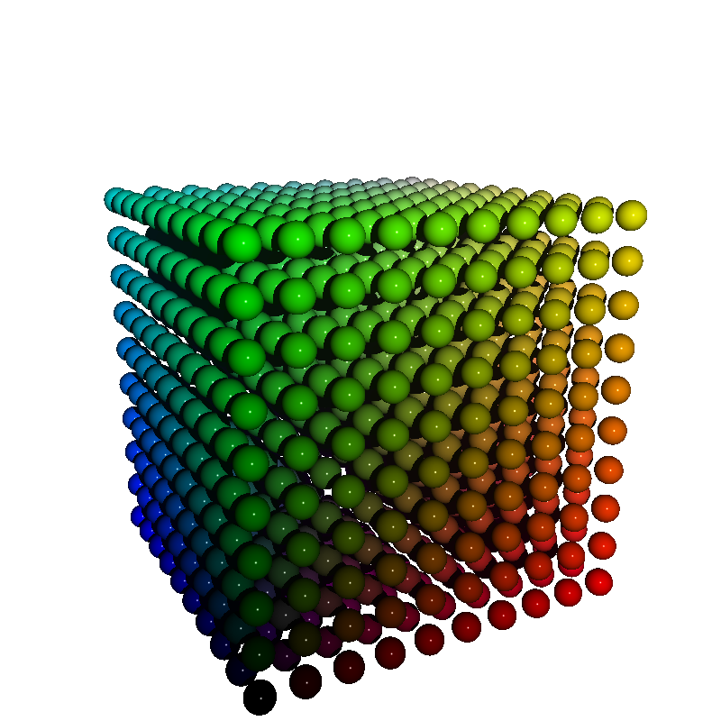
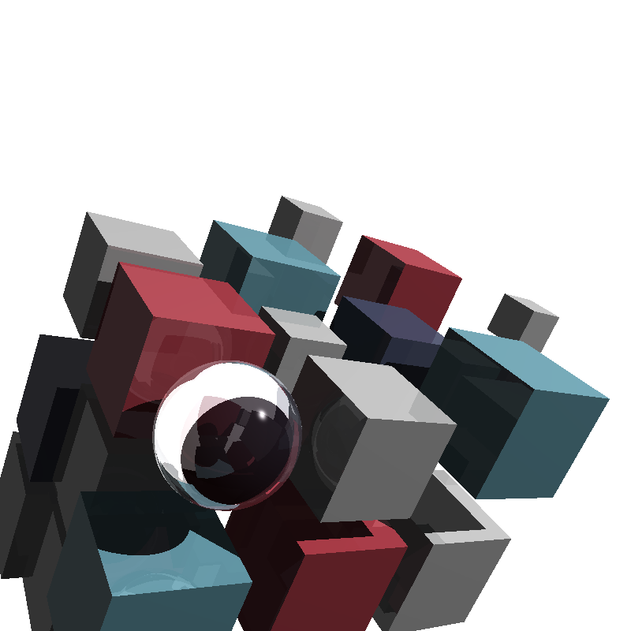
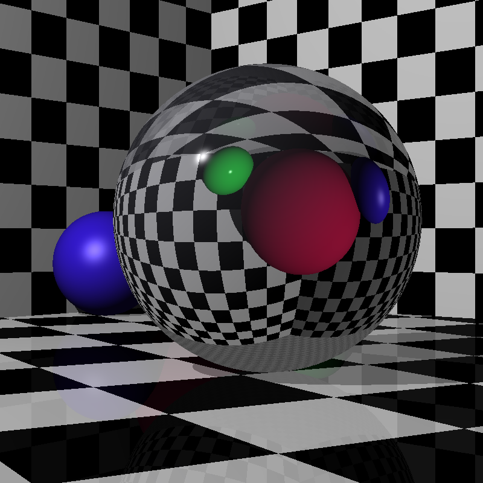
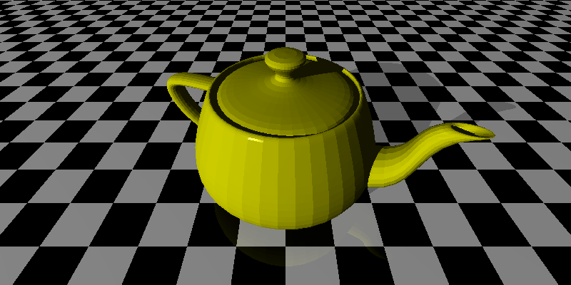

## A Ray Tracer in Zig

The code in this repository mostly follows the book [The Ray Tracer Challenge](http://www.raytracerchallenge.com/) by Jamis Buck with some additional enhancements.

Some extra features not in the original book:

* Bounding boxes [bonus chapter](http://raytracerchallenge.com/bonus/bounding-boxes.html)
* Multi-threading rendering
* Antialiasing
* Torus primitive

Although all the chapters in the book have been implemented, there's a lot more I'd like to do. I guess once the `ray-tracing bug` bites you, there's no stopping :) These are some of the features I'll be working on in the near future:

* Improve this README with examples and pretty pictures
* Texture mapping [bonus chapter](http://www.raytracerchallenge.com/bonus/texture-mapping.html)
* Support textures from .OBJ files
* Multiple lights
* Support shapes in groups in yaml files

In order to build the ray tracer you need Zig 0.17.0 or later.

```
% git clone git@github.com:sigfpe8/Ray-Tracing.git
...
% cd Ray-Tracing
% zig version
0.17.0
% zig build -Doptimize=fast
```

The executable is `./zig-out/bin/rt`. There are some built-in demos you can try out of the box. 

```
% ./zig-out/bin/rt -d spheres -w 800 -h 800

Rendering spheres.ppm (800x800) with 4 threads
Rendered 640,000 pixels in 1 s

Primary rays:         640,000
Reflected rays:             0
Refracted rays:             0
Shadow rays:          640,000
Total # of rays:    1,280,000 
```

The output file is `spheres.ppm`, which you can easily open with any graphics program. On macOS you can open it in Preview and use `File | Export` to create a `.png` version. Instead of `spheres` you can also try `csg` (Constructive Solid Geometry) and `torus`.



If not tracing any of the demos (`-d` option), you need a `YAML` file with a scene description. In this case you just pass the file name as the single argument. `YAML` scene descriptions can be self-contained (meaning they just refer to primitives like spheres, cubes and planes) or they may refer to an external file with a triangle mesh in `.OBJ` format.

A couple of self-contained scenes:

```
% ./zig-out/bin/rt scenes/book-cover.yml     

Rendering scenes/book-cover.ppm (800x800) with 4 threads
Rendered 640,000 pixels in 419 ms

Primary rays:         640,000
Reflected rays:       768,555
Refracted rays:       197,694
Shadow rays:        1,403,013
Total # of rays:    3,009,262
```



```
% ./zig-out/bin/rt scenes/refraction-bend.yml

Rendering scenes/refraction-bend.ppm (800x800) with 4 threads
Rendered 640,000 pixels in 380 ms

Primary rays:         640,000
Reflected rays:       250,074
Refracted rays:       546,312
Shadow rays:        1,436,386
Total # of rays:    2,872,772
```



In order to render a scene with an object that is described by a triangle mesh you must put its `.OBJ` file in the same directory as the `.YAML` file. For example, here's the notorious Utah teapot:

```
% cd scenes
% wget https://groups.csail.mit.edu/graphics/classes/6.837/F03/models/teapot.obj
 ...
% ../zig-out/bin/rt teapot.yml                                                  

Reading teapot.obj
     Read lines: 9965
  Ignored lines: 0
       Vertices: 3645
              X: [-3, 3.434]
              Y: [0, 3.15]
              Z: [-2, 2]
Vertex textures: 1
 Vertex normals: 1
      Triangles: 6320
       Polygons: 0 (0)
         Groups: 0
        Objects: 0
         Memory: 2 MB
   Elapsed time: 2 ms

Rendering teapot.ppm (800x400) with 4 threads
Rendered 320,000 pixels in 7 s

Primary rays:         320,000
Reflected rays:       259,439
Refracted rays:             0
Shadow rays:          330,814
Total # of rays:      910,253
```




